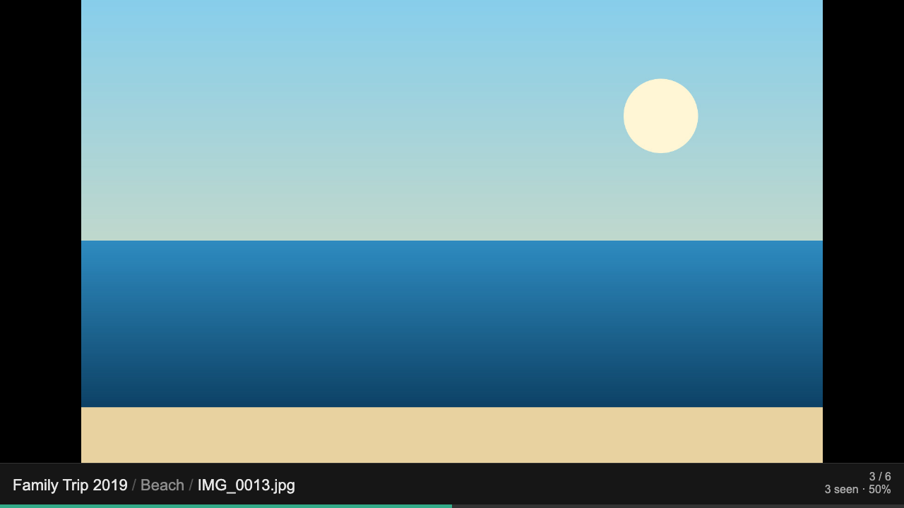
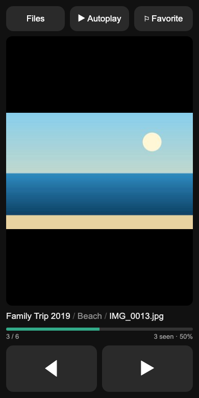

# File Presenter

Browse every file on a USB drive or in a folder in a single browser window, controlled from your phone. For Mac and Windows.

<p align="center">
  
  &nbsp;
  
</p>

## Download

Get **File Presenter.app** (Mac), **file-presenter.exe** (Windows) and the **User Guide** PDF from the [latest release](https://github.com/LadariousX/file-presenter/releases/latest). The user guide covers first-time setup and full screen on both.

## Run

Video thumbnails use **ffmpeg** if it's installed (`brew install ffmpeg` on Mac, `winget install Gyan.FFmpeg` on Windows) or sits in the same folder as the program. Without it, Macs fall back to Quick Look and Windows shows a placeholder.

```
./file-presenter                       # the browser opens a folder picker
./file-presenter "/Volumes/NO NAME"    # or pass the folder (Windows: file-presenter.exe E:\)
./file-presenter -port 9000 -no-open
```

Double-click **File Presenter** (Mac) or `file-presenter.exe` (Windows). Your default browser opens to a folder picker: pick the USB drive (or any folder) and press **Present this folder**. The picker only works on the computer itself, so phones on the network can't browse your disk.

The presentation then shows a setup screen with a QR code. Scan it with the phone and the setup screen slides away. It slides back if the remote has been disconnected for 20 seconds. To show it on purpose (for example, to connect a different phone), move the mouse and click **📱 Set up remote**, which slides up from the bottom. A small **File Presenter** window stays open while it runs, with a link that opens the viewer again if it didn't appear. Close that window (or ⌘Q on Mac) to stop the app. The viewer tab closes itself. When run from a terminal, Ctrl-C also quits. Opening the app while it's already running just opens the viewer again. The ← / → keys also work on the computer.

The first time it runs, the firewall may ask whether to allow network access. Allow it (Windows: **Private networks**), or the phone can't connect.

Videos and audio play with sound. Browsers only allow sound after a click or key press on the page, and pressing **Present this folder** counts. If you started with a folder on the command line instead, click anywhere on the presentation once. If a browser still refuses, the video plays muted and its volume control unmutes it.

### Build

Requires Go 1.22+. On a Mac, `./build.sh` builds everything with the app icon into `dist/`:

- `File Presenter.app`: Mac, Apple Silicon and Intel in one app.
- `file-presenter.exe`: Windows, with the icon built in and no console window.
- `File Presenter User Guide.pdf`: from `USER_GUIDE.md` (needs Chrome, Chromium or Edge installed to print it).

The Mac window uses Cocoa through cgo, so the Mac app has to be built on a Mac (Xcode command line tools). The Windows window calls Windows directly, so the `.exe` builds from anywhere. `go run .` works for development.

### Layout

| Path | What's there |
|---|---|
| `main.go` | startup and shutdown |
| `internal/library/` | the presented folder: file order, progress, favorites, skip duplicates, autoplay, thumbnails |
| `internal/server/` | web routes, remote WebSocket, folder picker, network address; `web/` holds the pages |
| `internal/desktop/` | the native "File Presenter is running" window (Mac: Cocoa, Windows: Win32), opening the browser |
| `docs/` | screenshots for this README |
| `assets/` | the icon: `icon.svg` (source) and `icon.png` (1024 px); `build.sh` lists the commands to regenerate the copies |
| `USER_GUIDE.md` | the user guide; `build.sh` prints it to `dist/File Presenter User Guide.pdf` with `tools/userguide` |
| `build.sh` | builds `dist/` |

## Remote

Scan the QR code on the setup screen, or open the `Remote:` URL the program prints at startup (for example `http://Your-Computer.local:8000/remote`). The address uses the computer's network name, so a bookmark keeps working when the IP changes. If the name doesn't work on the network, it uses the IP instead. The phone has to be on the same network, or the computer has to be on the phone's hotspot.

The remote stays connected over a WebSocket. Button presses go to the computer immediately, and the screen updates as soon as anything changes. If the connection drops (phone asleep, Wi-Fi change), it shows *Reconnecting…* and reconnects automatically.

- ◀ / ▶ step through files. ⏯ (videos and audio only) plays or pauses.
- **⚐ Favorite** moves the current file into `Favorites/` at the top of the chosen folder. The flag fills in (**⚑**) while it's a favorite. Tap it again to move the file back to where it came from. Original locations are recorded in `Favorites/.favorites.json`.
- **▶ Autoplay** moves to the next file every 5 seconds. Videos and audio play to the end first. It stops at the last file, and the setup screen doesn't come down while it runs, even if the phone goes to sleep.
- **Files** browses folders with seen counts.
  - Tap a folder to open it, or tap its ▶ to start playing from its first file.
  - Tap a file to jump to it.
  - ← Up highlights the folder you came from.
  - **Skip duplicates**: ◀ / ▶ pass over copies of files you've already viewed somewhere else (same name *and* same size).
  - **Clear progress** resets what you've seen.

## How files are shown

Files go to the browser as they are, nothing is converted.

| Type | Shown as |
|---|---|
| JPG / PNG / GIF / BMP / WebP | image (HEIC and TIFF only where the browser supports them, e.g. Safari) |
| MP4 / MOV / WebM | video player |
| MP3 / M4A / WAV / FLAC | audio player |
| PDF | the browser's PDF viewer |
| TXT / CSV / JSON | text |
| anything else, or a format the browser can't play (e.g. WMV in Chrome) | its thumbnail and *"This browser can't open this file"* |

Files are ordered the way Windows Explorer shows them: folders first, natural number order.

## What's stored

- **Thumbnails**: in memory only (400 px, at most 600 kept, about 15 MB).
- **Progress**: one file per presented folder, at `~/Library/Application Support/file-presenter/` on Mac and `%AppData%\file-presenter\` on Windows.
